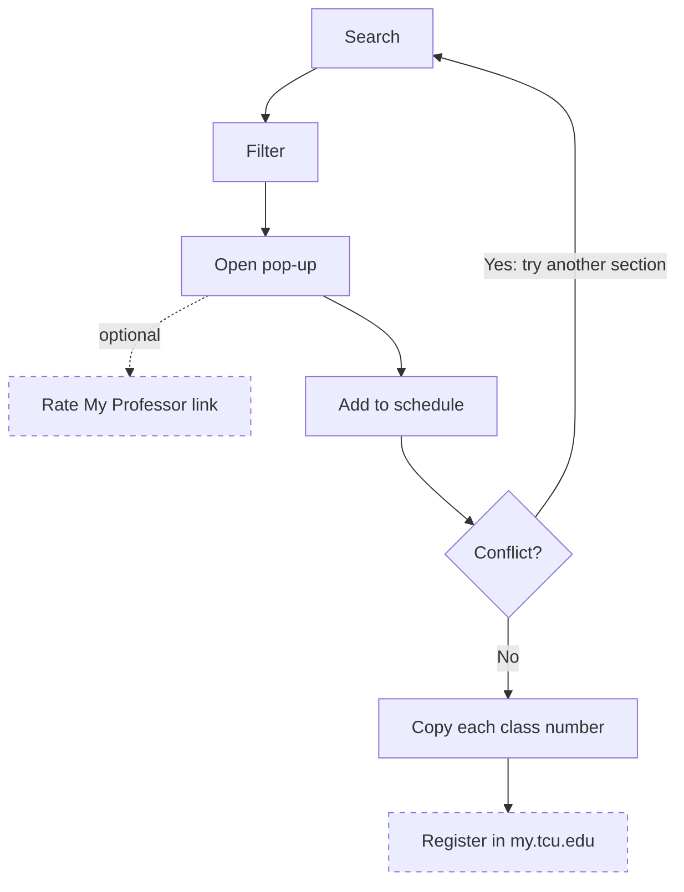

# Use cases

**Actors:** Student (primary), Admin (Elliott or Tanner), and my.tcu.edu (external; TCU's registration system).

## Summary

| ID | Use case | Actor | Main flow | MVP? |
|---|---|---|---|---|
| UC-01 | Search classes | Student | Open Classify → term is Spring 2027 → type a subject, course number, or title words → results appear instantly | Yes |
| UC-02 | Filter results | Student | Narrow by days, start time, status, session, instruction mode, course level → list updates live | Yes |
| UC-03 | View class details | Student | Tap a result → pop-up (not a new page) shows every non-empty field, 12-hour times, session dates, status as of scrape, class number with copy | Yes |
| UC-04 | Check the professor | Student | For showcase classes, tap "Rate My Professor" in the pop-up → RMP opens in a new tab | Yes (showcase only) |
| UC-05 | Add to schedule from search | Student | Tap Add on a result or in the pop-up → the section appears on the weekly calendar at once → conflicts are flagged | Yes |
| UC-06 | Manage the schedule | Student | Remove a section, swap it for another section of the same course and component, or hide/show backups | Yes |
| UC-07 | Keep the schedule | Student | Close or reload → the schedule restores from browser storage | Yes |
| UC-08 | Hand off to register | Student | Tap Copy on each scheduled class → open my.tcu.edu → enroll via the Purple Schedule Builder, Add Classes, or Shopping Cart | Yes |
| UC-09 | Refresh class data | Admin | Replace the JSON → validate → redeploy → the timestamp updates | Yes (internal) |
| UC-10 | Filter by Core requirement | Student | Pick a Core code → see sections that satisfy it | Yes (D-15) |
| UC-11 | See RMP ratings in the app | Student | Ratings shown inline | Later (needs a permitted source) |
| UC-12 | See instructor photos and names for all classes | Student | Photo and name in the pop-up | Later (needs TCU's OK or a directory scrape) |
| UC-13 | Share a schedule | Student | Opt-in private link | Later |
| UC-14 | Sign in with TCU; "what I still need" | Student | App knows remaining requirements | Later (needs TCU) |
| UC-15 | Recommended schedule / course score | Student | — | Later, maybe never; not the product's main job |

## Main student journey

Register in my.tcu.edu and the RMP link are outside the app.

## MVP use case details

### UC-01: Search classes

**Preconditions:** The page has loaded the Spring 2027 data.

**Main flow**
1. The student opens Classify. The term shows as Spring 2027.
2. The student types a subject, a course number, or title words.
3. Results update while typing.

**Alternate flows and edge cases**
- **No results:** show a no-results message and a way to clear the search and filters.
- **Closed class:** it appears with a "Closed as of …" chip and can still be added (BR-21).
- **TBA or online class:** the row omits days and times it doesn't have (BR-18).
- **Data fails to load:** show an error message, not an empty list.
- **Stale data:** the MVP shows no warning (D-28). The timestamp and "as of" labels still show the data's age.

**Postconditions:** Matching results are listed. Nothing is saved.

**Related:** BR-04, BR-05, BR-06, BR-07, BR-18, BR-19 · FR-01, FR-02, FR-11, FR-12, FR-13, FR-29, FR-30, FR-32, FR-36, FR-41

### UC-02: Filter results

**Preconditions:** The data has loaded.

**Main flow**
1. The student picks one or more filters: days, start time, status, session, instruction mode, or course level.
2. The list updates live.
3. The student clears a filter or all filters to widen the list.

**Alternate flows and edge cases**
- **No results:** show the no-results state and offer to clear filters.
- **TBA section with a day or time filter on:** it doesn't match, because it has no days or times.
- **Permit section with status set to Open:** it doesn't match (BR-21).

**Postconditions:** The list reflects every active filter.

**Related:** BR-05, BR-21 · FR-03, FR-04, FR-05, FR-06, FR-07, FR-08, FR-10, FR-36, FR-41

### UC-03: View class details

**Preconditions:** A result is visible.

**Main flow**
1. The student taps a result.
2. A pop-up opens on the same page.
3. It shows every non-empty field, 12-hour times, session start date, status as of the scrape, and the class number with a copy button.
4. The student closes it with Esc, an outside click, or the close button.

**Alternate flows and edge cases**
- **Permit section:** status reads Closed, with the permit detail beside it (BR-21).
- **TBA or online section:** no meeting time row appears, and the section is marked as having no set time.
- **Copy fails:** the class number stays visible and selectable, with a message to copy it by hand.
- **No reserve limit:** that label isn't rendered (BR-18).
- **Course also lists labs:** the pop-up says so (FR-42).
- **Times may be incomplete:** the pop-up says to check classes.tcu.edu (FR-43).

**Postconditions:** The pop-up is closed and focus returns to the row that opened it.

**Related:** BR-05, BR-06, BR-07, BR-18, BR-19, BR-20, BR-21 · FR-12, FR-13, FR-14, FR-15, FR-37, FR-42, FR-43

### UC-04: Check the professor

**Preconditions:** The section has an entry in `data/instructors_showcase.json`.

**Main flow**
1. The student opens the pop-up.
2. The student taps "Rate My Professor".
3. RMP opens in a new tab.

**Alternate flows and edge cases**
- **Not a showcase class:** no instructor row and no RMP link appear (BR-18).

**Postconditions:** Classify is unchanged in its own tab. No RMP data enters the app.

**Related:** BR-02, BR-13, BR-18 · FR-12, FR-33

### UC-05: Add to schedule from search

**Preconditions:** The data has loaded.

**Main flow**
1. The student taps Add on a result or in the pop-up.
2. The section appears on the weekly calendar at once.
3. The button changes to "Added ✓".
4. The app checks for conflicts and autosaves.

**Alternate flows and edge cases**
- **Conflict:** both sections stay, get a red outline, and a banner names them (BR-09).
- **Duplicate add:** a section already on the schedule can't be added twice. Its button shows "Added ✓" and does nothing. The student removes a section with the Remove control.
- **Closed class:** it can be added. The chip still shows Closed.
- **TBA or online class:** it goes to the Unscheduled list (BR-10).
- **Class outside the default grid:** the grid expands to fit it (FR-20).
- **Lab and lecture:** each is added on its own, because the data doesn't pair them. The app points out labs the course lists (BR-11, FR-42).
- **Times may be incomplete:** the section shows a note, because a conflict could be missed (FR-43).
- **Storage full or disabled:** the section stays on screen and a warning says it won't be saved (FR-26).

**Postconditions:** The section is on the schedule and saved, if storage is available.

**Related:** BR-08, BR-09, BR-10, BR-11, BR-12 · FR-16, FR-20, FR-21, FR-22, FR-23, FR-24, FR-26, FR-34, FR-42, FR-43

### UC-06: Manage the schedule

**Preconditions:** At least one section is on the schedule.

**Main flow**
1. The student removes a section, or
2. swaps it for another section of the same course and component, or
3. hides or shows a backup.
4. The calendar and conflict warnings update, and the schedule autosaves.

**Alternate flows and edge cases**
- **Only one section of the course exists:** swap isn't offered.
- **Swap creates a conflict:** the swap completes and the warning appears (BR-09).
- **Hiding a conflicting section:** hidden sections don't count as conflicts, so the warning clears.
- **Storage full or disabled:** the change applies on screen, and the warning stays visible.

**Postconditions:** The schedule reflects the change and is saved, if storage is available.

**Related:** BR-08, BR-09, BR-12 · FR-17, FR-18, FR-19, FR-21, FR-22, FR-24, FR-26

### UC-07: Keep the schedule

**Preconditions:** The student built a schedule in this browser earlier.

**Main flow**
1. The student closes or reloads the page.
2. On return, the app reads the saved schedule.
3. The calendar is restored, including hidden flags.

**Alternate flows and edge cases**
- **Storage disabled:** the app starts empty with a warning.
- **Saved data is corrupt or an unknown version:** the app starts empty and doesn't crash.
- **A saved class number no longer exists after a data refresh:** drop it and tell the student which number was removed.
- **Saved schedule is for another term:** don't load it into this term.
- **Another device:** nothing is restored; there's no sync in the MVP (D-05).

**Postconditions:** The saved schedule is on screen. No schedule data left the browser (NFR-06).

**Related:** BR-12, BR-15, BR-17 · FR-24, FR-25, FR-26

### UC-08: Hand off to register

**Preconditions:** At least one section is on the schedule.

**Main flow**
1. The student taps Copy on a scheduled class.
2. The app copies that class number and confirms. The student repeats this per class while enrolling (D-31).
3. The student taps "Register in my.tcu.edu ↗", which opens a new tab.
4. The student enrolls in my.tcu.edu through the Purple Schedule Builder, Add Classes, or Shopping Cart.

**Alternate flows and edge cases**
- **Empty schedule:** there's nothing to copy, and a hint says to add classes.
- **Copy fails:** the number stays visible and selectable.
- **Section shows Closed or conflicts:** its number still copies. The app doesn't judge the schedule.
- **Status changed since the scrape:** my.tcu.edu is the authority. The status label already says it is a snapshot (BR-05).

**Postconditions:** The student has the numbers. Classify enrolled no one (BR-01).

**Related:** BR-01, BR-05, BR-07 · FR-27, FR-28, FR-30

### UC-09: Refresh class data

**Preconditions:** A new scrape exists, run under BR-03. The admin has deploy access.

**Main flow**
1. The admin replaces the JSON and updates `data/term_meta.json`.
2. The admin runs `python scripts/validate_data.py` and `pytest`.
3. The admin redeploys.
4. The site shows the new "Class data as of …" date.

**Alternate flows and edge cases**
- **Validation fails:** don't deploy. Fix the data or the scraper.
- **Validation gives warnings:** review them; they don't stop a deploy.
- **Invalid data reaches startup:** the app fails loudly and doesn't serve bad data (NFR-07).
- **Stale data:** the old timestamp stays visible until the refresh ships (BR-04).

**Postconditions:** Students see the new data and timestamp.

The steps are in the [data refresh runbook](06-data-dictionary.md#data-refresh-runbook).

**Related:** BR-02, BR-03, BR-04 · FR-29, FR-35, FR-38, FR-39, FR-40

### UC-10: Filter by Core requirement

**Preconditions:** The data has loaded.

**Main flow**
1. The student picks one or more Core codes, such as HUM or SSC.
2. The list shows sections carrying any selected code.
3. The student opens or adds a section as usual.

**Alternate flows and edge cases**
- **No results:** show the no-results state.
- **Section with no Core codes:** it is left out while a Core filter is on, and it shows no Core row (BR-18).

**Postconditions:** The list reflects the Core filter.

**Related:** BR-18, BR-20 · FR-09, FR-10, FR-11, FR-12, FR-14, FR-36
