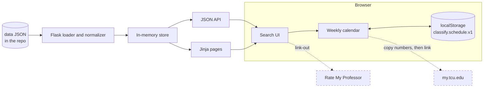

# Architecture

## Overview

Classify is one Flask app using the app-factory pattern (D-03). At startup it:

1. Loads the JSON from `CLASSIFY_DATA_PATH`, the timestamp from `CLASSIFY_META_PATH`, and corrections from `data/overrides.json`.
2. Validates them and fails loudly if they are bad (NFR-07).
3. Normalizes records into `Section` and `Meeting` objects (FR-39).
4. Builds simple indexes by subject and by class number.

There is no database in the MVP (D-04).



my.tcu.edu and Rate My Professor are external. The app sends them nothing.

## Modules

| Path | Job |
|---|---|
| `app/__init__.py` | `create_app()`: config, data, blueprints |
| `app/config.py` | Reads environment variables |
| `app/data_loader.py` | Loads, validates, and normalizes data |
| `app/models.py` | `Term`, `Section`, `Meeting` dataclasses |
| `app/timefmt.py` | Day and time parsing and formatting |
| `app/conflicts.py` | BR-08 reference rule (FR-21) |
| `app/routes/pages.py` | Page shell at `/` |
| `app/routes/api.py` | JSON API (FR-35 to FR-38) |
| `app/search.py` | Section JSON, param validation, and filters |
| `app/responses.py` | Compression, caching, and security headers |
| `app/static/js/app.js` | Entry point: wires up search, calendar, popup, and storage on load |
| `app/static/js/search.js` | Search, filters, and results (FR-01 to FR-14, FR-41) |
| `app/static/js/calendar.js` | Weekly grid, add/remove/swap/hide, Scheduled classes list, conflicts (FR-16 to FR-23, FR-27, FR-42) |
| `app/static/js/conflicts.js` | BR-08, the browser twin of `app/conflicts.py` (D-20) |
| `app/static/js/popup.js` | Same-page class detail pop-up (FR-14, FR-15, FR-33, FR-42, FR-43, NFR-04) |
| `app/static/js/clipboard.js` | Copy a class number, with a by-hand fallback (FR-15, FR-27) |
| `app/static/js/storage.js` | Autosave and restore (FR-24 to FR-26) |
| `scripts/validate_data.py` | Pre-deploy data check (FR-40) |

## Search and filter location

**Recommendation (D-19): run search and filter in the browser.** The page fetches `GET /api/sections` once, then filters locally.

| Factor | In the browser (chosen) | Through the API on each change |
|---|---|---|
| Speed | No network wait per keystroke | Depends on Wi-Fi during registration |
| Server load | One compressed fetch per visit | Many requests per student per visit |
| Payload | 111 KB gzipped, measured on current Spring data | Small per request |
| Dataset size | 3,926 rows, small enough for a phone | Handles much larger data |
| Azure quota | Light on CPU, which matters on the Free tier | Heavier |

The API params in FR-36 remain for testing and later use, but the UI doesn't call them on each change. Long result lists render incrementally so the page stays smooth (NFR-01).

## API

| Endpoint | Returns |
|---|---|
| `GET /api/health` | `{"status": "ok"}` |
| `GET /api/meta` | Term, `scraped_at`, source, and record count |
| `GET /api/sections` | `{"count": n, "sections": [...]}` |
| `GET /api/sections/<class_nbr>` | One section. 400 if not 5 digits, 404 if unknown |

Fields with no value are left out of section JSON (BR-18). `end_date` is for conflict checks only.

`GET /api/sections` takes these optional params. Bad values and unknown params return 400 with `{"error": "invalid_param", "param": ..., "message": ...}`.

| Param | Format | Example |
|---|---|---|
| `q` | Words matched against course code and title, up to 100 characters | `q=intro sociology` |
| `subject` | A subject in the data | `subject=ACCT` |
| `days` | Comma-separated day names | `days=Mon,Wed,Fri` |
| `start_from`, `start_to` | 24-hour `HH:MM`, inclusive | `start_from=09:00` |
| `status` | `Open` or `Closed` | `status=Open` |
| `session` | A session code in the data | `session=8W1` |
| `mode` | An instruction mode in the data | `mode=Online Only` |
| `level` | `10000-29999`, `30000-49999`, or `50000-plus` | `level=30000-49999` |
| `core` | Comma-separated Core codes; any may match | `core=HUM,SSC` |

With no params, the response is built and compressed once at startup. It carries an ETag, so a repeat visit can get a 304 with no body. Other responses are compressed per request.

## Browser storage

The schedule is stored in localStorage under a versioned key. It holds only the term code, class numbers, and visibility flags:

```json
{
  "version": 1,
  "term_code": "4273",
  "items": [{"class_nbr": "34429", "visible": true}]
}
```

Bumping the key's version lets a later release migrate or discard old data safely. Schedules never leave the browser (NFR-06).

## One source of truth for shared logic

**Recommendation (D-20):**

| Logic | Where it runs | How it stays consistent |
|---|---|---|
| Parsing days and times; 12-hour formatting | Python only (`app/timefmt.py`) | The API sends 24-hour `start_time` and `end_time`, plus a ready-made `meeting_text`. The browser doesn't format times |
| Conflict rule (BR-08) | Browser at runtime (`app/static/js/conflicts.js`); `app/conflicts.py` is the reference | Both pass the same case file, `tests/fixtures/conflict_cases.json` (FR-21) |

The conflict rule must run in the browser because the schedule can't be sent to the server (NFR-06). The Python version is tested with pytest (`tests/test_conflicts.py`). The JavaScript version is tested with Node's built-in test runner (`tests/js/conflicts.test.mjs`, run with `node --test tests/js`), which needs no npm packages and no build step; CI installs Node only to run it.

## Date ranges

The data has only `start_date` (OQ-02). Under D-21, the loader finds each session's start date in the data, and then:

- A numbered session ends the day before the next session in its family starts. 8W1 ends before 8W2. 4W1 ends before 4W2.
- The last session in a family, REG, and unknown codes get `end_date = null`, which counts as overlapping (BR-08).

For Spring 2027, 8W1 runs 01/19/27 to at most 03/21/27. 8W2 starts 03/22/27. The derived date is an upper bound used only for conflict checks, so the UI doesn't show it as an end date.

## Future path

| Change | Trigger |
|---|---|
| SQLite or PostgreSQL | The data grows or accounts arrive |
| An official TCU data feed replaces the scrape | TCU agrees (D-08). Only the loader should change |
| App Service scale-up or scale-out | Traffic or quotas require it. See [deployment](08-deployment-azure.md) |

## Risks

| Risk | Impact | Mitigation |
|---|---|---|
| TCU changes classes.tcu.edu and the scraper breaks | No new data | `validate_data.py` catches shape changes. The site keeps the last good data, with its timestamp |
| TCU moves off PeopleSoft (many schools are moving to Workday) | The data source changes | Keep source-specific logic in the loader |
| Registration-day traffic | Slow site or quota limit | Serve from memory, compress, cache, and move up a tier beforehand (NFR-02, OQ-08) |
| Stale status data | Students trust an old status | Timestamp and snapshot labels (BR-04, BR-05). A stale warning comes later (FR-31) |
| Scrape drops extra meeting patterns | Missed conflicts, mostly in math | Rescrape with one row per meeting (OQ-24). Until then, flag affected sections (FR-43) |
| Bus factor after the team graduates in May 2027 | The project dies | Recommend a student org to take over. Keep docs current |
